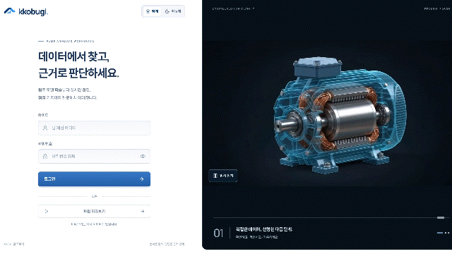
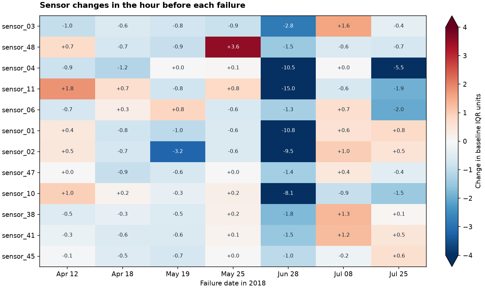

  

<h2 align="center">멈추지 않는 제철소, 그 곁에 꼬부기</h2>

  모델을 학습하고 RAG 챗봇 어시스턴스를 활용한 검토 결과를 보고서로 남기는 펌프 점검 지원 웹 서비스

  <a href="https://github.com/kkobugi-KNDA/kkobugi"><b>분석·개발 과정 보기 ↗</b></a>

---

## 꼬부기로 할 수 있는 일

| 데이터 검사 | 모델 비교와 선택 | 구간 확인과 현장 관찰 | 보고서와 비용 비교 |
| :--- | :--- | :--- | :--- |
| 전처리한 CSV를 올리면 시간·라벨·채널을 검사하고 고칠 위치를 알려줍니다. | XGBoost·AutoEncoder를 학습해 Valid 지표 순으로 비교하고, 사용자가 고른 모델만 Test로 평가합니다. | 시계열과 예측 구간을 보며 현장 관찰을 기록하고 수정 이력을 남깁니다. | 모델 결과와 관찰을 근거로 검토를 완료하고, 점검·수리·중단 비용 시나리오를 비교합니다. |

## 사람이 판단하는 업무 흐름

| 분석 담당자 | 점검 담당자 |
| :--- | :--- |
| **데이터 등록 → 모델 비교 → 모델 선택** | **구간 확인 → 관찰 기록 → 검토 완료 · 보고서** |
| 전처리 데이터를 올려 검사를 통과시키고, 같은 검증 지표로 모델을 비교해 목적에 맞는 모델을 직접 선택합니다. | 선택한 모델이 표시한 구간과 현장 관찰을 함께 확인하고, 근거를 남겨 검토를 완료한 뒤 보고서로 전달합니다. |

꼬부기는 **모델 결과 확인 뒤에 남는 관찰 정리, 근거 확인, 보고서 작성과 전달**을 한 흐름으로 연결합니다.
AI는 판단 근거를 정리하고, 고장 확정과 조치 완료는 담당자가 직접 결정합니다.

## 데이터에서 찾은 고장 신호

2018년 4~8월 펌프 센서 52개의 1분 기록 22만 행에서 고장 7건 직전의 변화를 추적했습니다.
`sensor_04`의 360분 z-score 규칙은 7건 모두에서 고장 전 6시간 안에 경보를 냈고, 정상 구간 오경보는 0.13%였습니다.

---

  POSCO AI HACKATHON 2026 
  Kaggle Pump Sensor Data(공개 물 펌프 데이터)로 기능을 검증한 서비스 프로토타입입니다. 화면의 관찰 문장과 비용은 시연용 예시입니다.

